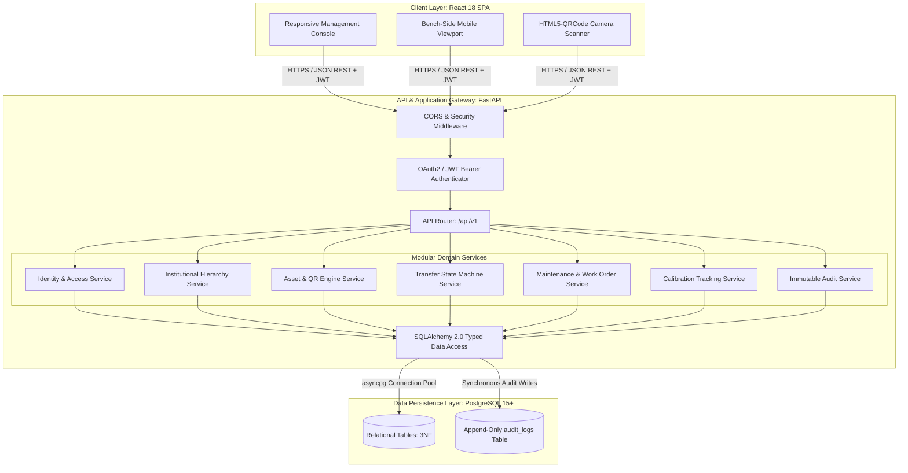

# 01. System Architecture Specification

## 1. Architectural Style & Monolithic Justification
The system adopts a **Modular Monolithic Architecture** pattern. 

### Why Modular Monolith Over Microservices?
1. **Organizational Scale:** Haramaya University operates 90–150+ laboratories. A modular monolith cleanly supports this volume with zero network serialization overhead between modules.
2. **ACID Transaction Guarantees:** Relational integrity during multi-step asset transfers and work order closures requires strict ACID consistency. Distributed microservice transactions (Saga patterns, 2PC) introduce unnecessary complexity and failure modes.
3. **Hardware Constraints:** The system is optimized to develop and deploy efficiently on modest institutional infrastructure and standard development laptops with **8 GB RAM**. Microservices with multiple containers or service meshes would saturate host memory.
4. **Logical Modularity:** Domain modules (Assets, Transfers, Maintenance, Hierarchy) are isolated behind clear service interfaces, enabling clean refactoring into independent services in the future if university-wide integration necessitates it.

---

## 2. High-Level System Architecture Diagram



---

## 3. Layered Communication & Component Responsibilities

### 1. Presentation Layer (React 18 SPA)
- Built with Vite, TypeScript, and Tailwind CSS.
- Integrates `html5-qrcode` to access smartphone and tablet cameras directly from standard mobile browsers without requiring native mobile installation.
- Utilizes Axios for HTTP communication with automatic request interception for JWT Bearer attachment and response interception for 401 token refresh cycles.

### 2. Application & API Layer (FastAPI)
- Handles incoming HTTP requests, validates request payloads against Pydantic v2 schemas, and translates exceptions into standard RFC 7807 Problem Details.
- Enforces strict server-side Role-Based Access Control (RBAC) via FastAPI dependency injection (`Depends()`).
- Coordinates domain business logic inside isolated services without mixing database queries into HTTP route handlers.

### 3. Data Access Layer (SQLAlchemy 2.0)
- Manages relational mapping using modern typed declarative mappings.
- Implements explicit eager loading (`selectinload`, `joinedload`) to prevent N+1 query performance degradation.
- Ensures transaction atomicity with automatic rollback on unhandled service exceptions.

### 4. Database Layer (PostgreSQL 15+)
- Stores relational data in Third Normal Form (3NF) across 12 core tables.
- Enforces referential integrity using foreign keys with `ON DELETE RESTRICT` for active asset connections.
- Houses the `audit_logs` table configured with database permissions that prohibit `UPDATE` and `DELETE` commands.

---

## 4. Error Handling Strategy (RFC 7807)
All API error responses follow the standard RFC 7807 specification:
```json
{
  "type": "https://errors.haramaya.edu.et/asset-conflict",
  "title": "Asset State Conflict",
  "status": 409,
  "detail": "Asset HU-HiT-CHEM-0014 is currently locked in TRANSFER_PENDING status.",
  "instance": "/api/v1/assets/b182fb5a-5ffb-46d5-bb90-07e4d82531cd/transfer",
  "code": "ERR_ASSET_LOCKED",
  "timestamp": "2026-11-11T14:30:00Z"
}
```

---

## 5. Backup and Recovery Considerations
- **Logical Daily Backups:** Automated daily PostgreSQL dumps using `pg_dump` scheduled during low-utilization windows (02:00 EAT).
- **Point-in-Time Recovery (PITR):** PostgreSQL Write-Ahead Logging (WAL) archiving enables recovery to any specific second in the event of hardware or storage failure.
- **Audit Ledger Protection:** Historical audit tables are retained indefinitely and excluded from automated archival purge routines.
