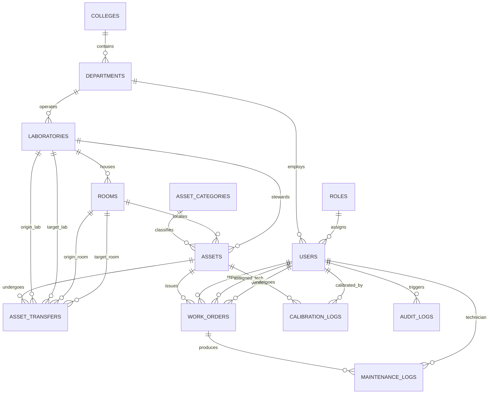

# 04. Database Design Specification

## 1. Database Architecture & Normalization Analysis
The persistence layer utilizes **PostgreSQL 15+**. The relational schema is engineered strictly to **Third Normal Form (3NF)**:
1. **First Normal Form (1NF):** All attributes contain atomic, scalar values. Repeating groups (such as multiple rooms or laboratory assignments) are decoupled into relational child tables.
2. **Second Normal Form (2NF):** All non-key attributes are fully functionally dependent on the entire primary key. Single-column surrogate UUID primary keys are utilized across all core entities.
3. **Third Normal Form (3NF):** Transitive dependencies are removed. Location hierarchy is cleanly partitioned into `colleges`, `departments`, `laboratories`, and `rooms`. An asset references both its custodian `laboratory_id` and current `room_id`; Stage 4 requires the selected room to belong to that laboratory. A shared-instrument/cross-laboratory exception described in the data dictionary has no approved workflow or exception record yet and is not implemented.

---

## 2. Entity Relationship Overview

---

## 3. Schema Scope

The schema contains **13 normalized tables**: `colleges`, `departments`, `laboratories`, `rooms`, `roles`, `users`, `asset_categories`, `assets`, `asset_transfers`, `work_orders`, `maintenance_logs`, `calibration_logs`, and `audit_logs`. The complete column-level specification is maintained in the [Data Dictionary](../database/data-dictionary.md).

---

## 4. Relational Safeguards & Integrity Constraints

### 1. Referential Integrity Actions (`ON DELETE RESTRICT`)
To ensure that historical asset data and audit records cannot be compromised:
- Deleting a `college`, `department`, `laboratory`, or `room` that houses active assets is strictly blocked (`ON DELETE RESTRICT`).
- Deleting an `asset` with linked `work_orders`, `asset_transfers`, or `calibration_logs` is blocked. BR-010 requires decommissioning rather than hard deletion, but Stage 4 does not implement a decommissioning transition because the condemnation evidence and authorization details remain unspecified.

### 2. Compound Uniqueness Constraints
- `assets(manufacturer_name, serial_number)`: Guarantees that duplicate serial numbers from the same manufacturer cannot be registered.
- `departments(college_id, code)`: Prevents duplicate department abbreviations within the same college.
- `rooms(laboratory_id, room_number)`: Prevents duplicate room labels within the same laboratory.

### 3. Partial & Performance Indexes
To ensure sub-200ms query performance on standard 8 GB RAM hardware:
- `idx_assets_code`: Unique B-Tree index on `assets.asset_code` for rapid QR lookups.
- `idx_assets_status`: B-Tree index on `assets.operational_status` for fast inventory filtering.
- `idx_assets_next_cal`: Index on `assets.next_calibration_due` for daily overdue batch evaluations.
- `idx_audit_entity`: Composite index on `audit_logs(entity_type, entity_id)` for lightning-fast asset history retrieval.

---

## 5. Preservation of Historical Records
- **Location History:** When an asset is transferred between laboratories, the `asset_transfers` table records the departure laboratory **and room**, destination laboratory **and room**, authorizing actors, and exact timestamp. The `assets` table only updates its active foreign key pointers once the transfer is finalized, so previous locations remain queryable.
- **Maintenance History:** Work orders and maintenance logs remain permanently linked to the asset UUID, providing a complete lifetime service logbook.

## 6. Implemented Database Slices

Stage 4 adds the approved `asset_categories`, `assets`, and `audit_logs` tables and their listed constraints/indexes. Asset and category mutations write JSONB snapshots in the same transaction, and a database trigger rejects audit-row updates and deletes. Asset records have no hard-delete or decommissioning API; BR-010's condemnation evidence and authorization details are unspecified. The serial-number uniqueness constraint remains unconditional pending DEC-06 confirmation.

Stage 5 adds `asset_transfers` using the approved data-dictionary fields only. Its restrictive foreign keys preserve the asset, origin/destination laboratories, origin/destination rooms, and actors. The asset continues to reference its origin location while status is `TRANSFER_PENDING`; ULMD completion updates its current laboratory and room while the transfer row preserves the previous location. The existing immutable audit table stores each state transition and corresponding asset status/location snapshot in the same transaction. No `asset_assignments` or shared-location table is introduced. The Stage 5 Alembic revision is additive and follows the existing migration history.

Stage 6 adds only `work_orders` and `maintenance_logs`, with restrictive asset/user/work-order foreign keys, approved check constraints, and ticket/status/asset/assignee indexes. Work-order state and asset-condition changes, maintenance log rows, and JSONB audit snapshots are committed atomically. No separate maintenance assignment/activity/outcome tables were added; current assignee and repair history use the approved work-order fields and append-only logs. `AWAITING_APPROVAL` remains a proposed DEC-02 state and is excluded from the Stage 6 status constraint until its approval policy is confirmed.
