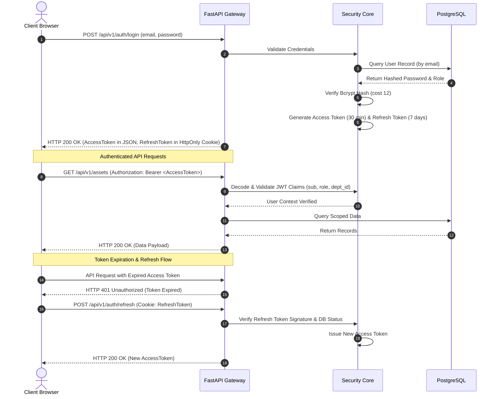

# 06. Authentication and Security Architecture

## 1. Threat Model & Security Posture
The Laboratory Asset Management and Maintenance Tracking System safeguards sensitive institutional assets, equipment location data, and maintenance records.

### Mitigated Threats
1. **Unauthorized Location Alteration ("Asset Theft / Ghost Assets"):** An unauthorized party modifying an asset's location to conceal its removal. -> *Mitigated via server-side dual-authorization transfer workflows and immutable audit logging.*
2. **Credential Sniffing & Session Hijacking:** Interception of user credentials across university networks. -> *Mitigated via TLS 1.3 transport encryption, salted bcrypt password hashing, and HttpOnly Secure cookies for refresh tokens.*
3. **Privilege Escalation:** A technician or departmental user attempting to approve cross-college asset condemnations. -> *Mitigated via server-side RBAC guards injected into every API endpoint.*
4. **SQL Injection & Data Tampering:** Direct database exploitation via user input fields. -> *Mitigated via SQLAlchemy 2.0 parameterized queries and strict Pydantic v2 input sanitization.*

---

## 2. Authentication Flow & Token Lifecycle



---

## 3. Role-Based Access Control (RBAC) Matrix

| System Action / Resource | `ULMD_ADMIN` | `MAINTENANCE_TECH` | `LAB_MANAGER` | `LAB_TECH` | `AUDITOR` |
|---|:---:|:---:|:---:|:---:|:---:|
| **Manage Users & Assign Roles** | Yes | No | No | No | No |
| **Manage Hierarchy (Colleges/Labs)** | Yes | No | No | No | No |
| **Register Durable Asset** | Yes | No | Yes (own lab) | No | No |
| **View Asset Passport & Specs** | Yes | Yes | Yes | Yes | Yes |
| **Initiate Equipment Transfer** | Yes | No | Yes (own lab) | No | No |
| **Accept Inbound Transfer** | Yes | No | Yes (target lab)| No | No |
| **Approve Final Transfer Relocation**| Yes | No | No | No | No |
| **Report Fault / Open Ticket** | Yes | Yes | Yes | Yes | No |
| **Assign Technician to Ticket** | Yes | No | No | No | No |
| **Submit Maintenance & Repair Log** | Yes | Yes | No | No | No |
| **Verify Repair & Close Ticket** | Yes | No | Yes (own lab) | No | No |
| **Record Certified Calibration** | Yes | Yes | No | No | No |
| **View Audit Trail & System Analytics**| Yes | No | Scoped | Scoped | Yes |

---

## 4. Security Implementation Rules

### 1. Cryptographic Password Hashing
```python
# Passlib CryptContext configuration
pwd_context = CryptContext(schemes=["bcrypt"], deprecated="auto", bcrypt__rounds=12)
```

### 2. JWT Claims Specification
```json
{
  "sub": "4164b360-15ef-4577-bc60-d72b22bbbe85",
  "email": "dr.meseret@haramaya.edu.et",
  "role": "ULMD_ADMIN",
  "dept_id": null,
  "iat": 1794500000,
  "exp": 1794501800
}
```

### 3. Cross-Origin Resource Sharing (CORS) Security
Strict origin verification is enforced. Wildcard origins (`*`) are disallowed when credential transmission is enabled:
```python
app.add_middleware(
    CORSMiddleware,
    allow_origins=["http://localhost:5173", "https://labs.haramaya.edu.et"],
    allow_credentials=True,
    allow_methods=["GET", "POST", "PUT", "PATCH", "DELETE", "OPTIONS"],
    allow_headers=["Authorization", "Content-Type", "Accept"],
)
```
