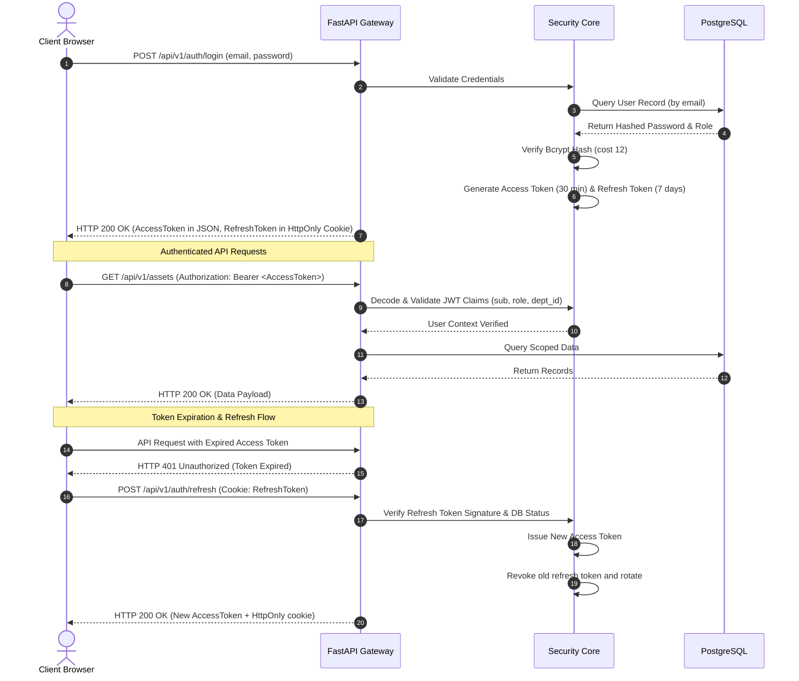

# 06. Authentication and Security Architecture

## Stage 2 Implementation Notes

- The five canonical roles and the approved `roles` / `users` fields are implemented. The `colleges` and `departments` parent tables are included only to satisfy the approved user foreign key; hierarchy management remains out of scope.
- User provisioning and role assignment are restricted to `ULMD_ADMIN`. There is no public registration endpoint. The first administrator is provisioned interactively through `python -m app.cli create-admin`.
- Refresh-token rotation uses an in-process revocation set, an option allowed by ADR-05. It supports the single-process development deployment but does not preserve revoked-token state across restarts or coordinate multiple workers. A persistent token store must be selected before multi-worker or production use.
- Stage 2 authentication events are written to structured application logs. The approved `audit_logs` entity is introduced in Stage 4 for asset and category mutations; this does not add a general audit browsing module.
- The architecture originally named Passlib as its bcrypt wrapper. Stage 2 uses the maintained `bcrypt` library directly at cost 12; the approved bcrypt format and work factor are unchanged.

## 1. Threat Model & Security Posture
The Laboratory Asset Management and Maintenance Tracking System safeguards sensitive institutional assets, equipment location data, and maintenance records.

### Mitigated Threats
1. **Unauthorized Location Alteration ("Asset Theft / Ghost Assets"):** An unauthorized party modifying an asset's location to conceal its removal. -> *Mitigated via server-side dual-authorization transfer workflows and immutable audit logging.*
2. **Credential Sniffing & Session Hijacking:** Interception of user credentials across university networks. -> *Mitigated via TLS 1.3 transport encryption, salted bcrypt password hashing, and HttpOnly Secure cookies for refresh tokens.*
3. **Privilege Escalation:** Unauthorized asset or category mutation. -> *Implemented asset/category endpoints enforce server-side role checks. Decommissioning has no endpoint because BR-010's condemnation evidence and authorization policy are not defined.*
4. **SQL Injection & Data Tampering:** Direct database exploitation via user input fields. -> *Mitigated via SQLAlchemy 2.0 parameterized queries and strict Pydantic v2 input sanitization.*

---

## 2. Authentication Flow & Token Lifecycle



---

## 3. Role-Based Access Control (RBAC) Matrix

| System Action / Resource | `ULMD_ADMIN` | `MAINTENANCE_TECH` | `LAB_MANAGER` | `LAB_TECH` | `AUDITOR` |
|---|:---:|:---:|:---:|:---:|:---:|
| **Manage Users & Assign Roles** | Yes | No | No | No | No |
| **Manage Hierarchy (Colleges/Labs)** | Yes | No | No | No | No |
| **Register Durable Asset** | Yes | No | Yes (own lab) | No | No |
| **View Asset Passport & Specs** | Yes | Yes | Yes | Yes | Yes |
| **Initiate Equipment Transfer** | Yes | No | Yes (own lab) | No | No |
| **Accept Inbound Transfer** | Yes | No | Yes (target lab)| No | No |
| **Approve Final Transfer Relocation**| Yes | No | No | No | No |
| **Report Fault / Open Ticket** | Yes | No | Yes | Yes | No |
| **Assign Technician to Ticket** | Yes | No | No | No | No |
| **Submit Maintenance & Repair Log** | Yes | Yes | No | No | No |
| **Verify Repair & Close Ticket** | Yes | No | Yes (own lab) | No | No |
| **Record Certified Calibration** | Yes | Yes | No | No | No |
| **View Scoped Operational Analytics** | Yes | No | Yes (own lab) | No | Yes |
| **View Immutable Audit Trail** | Yes | No | No | No | Yes |

> **Role canonicalization:** The five columns above are the only application roles. Department Heads and the Materials Unit use `AUDITOR` with department-scoped or university-wide read-only assignment respectively. There is no `DEPT_HEAD`, `INVENTORY_AUDITOR`, or `SYSTEM_ADMIN` application role in the MVP.

The approved matrix does not specify which roles may administer asset categories. Current category create/update/delete endpoints enforce `ULMD_ADMIN`, and the frontend shows the management page only to that role. Treat this as a provisional least-privilege implementation restriction, not an approved permission decision; do not broaden it until ULMD confirms the policy. Category activation/deactivation is not modeled.

### Stage 5 transfer enforcement

Transfer creation is restricted to `ULMD_ADMIN` and the designated manager of the origin laboratory. Receiver acceptance is restricted to `ULMD_ADMIN` or the designated manager of the target laboratory; only `ULMD_ADMIN` can perform final approval or reject a transfer awaiting approval. A target Lab Manager may reject a transfer awaiting receipt. Transfer listing and detail reads are available to `ULMD_ADMIN`, `AUDITOR`, and `LAB_MANAGER`; lab managers are limited to transfers whose origin or destination is a laboratory they currently manage. Every transition is revalidated in the backend, regardless of frontend visibility.

---

## 4. Security Implementation Rules

### 1. Cryptographic Password Hashing
```python
# bcrypt library configuration
bcrypt.gensalt(rounds=12)
```

### 2. JWT Claims Specification
```json
{
  "sub": "4164b360-15ef-4577-bc60-d72b22bbbe85",
  "email": "dr.meseret@haramaya.edu.et",
  "role": "ULMD_ADMIN",
  "dept_id": null,
  "jti": "unique-token-id",
  "iat": 1794500000,
  "exp": 1794501800
}
```

### 3. Cross-Origin Resource Sharing (CORS) Security
Strict origin verification is enforced. Wildcard origins (`*`) are disallowed when credential transmission is enabled:
```python
app.add_middleware(
    CORSMiddleware,
    allow_origins=settings.cors_origin_list,
    allow_credentials=True,
    allow_methods=["GET", "POST", "PUT", "PATCH", "DELETE", "OPTIONS"],
    allow_headers=["Authorization", "Content-Type", "Accept"],
)
```
`CORS_ORIGINS` is environment-configured. No production frontend origin is currently confirmed; the example `labs.haramaya.edu.et` origin shown in earlier design material was illustrative, not a configured production host.

### 4. Password Policy & Account Lockout
- Minimum length 10 characters, including at least one letter and one digit; passwords are never truncated.
- Passwords are hashed with bcrypt cost 12 and compared in constant time.
- Inputs exceeding bcrypt's 72-byte UTF-8 limit are rejected rather than truncated.
- Five consecutive failed login attempts set `users.locked_until = NOW() + 15 minutes` and reset `failed_login_attempts` on successful authentication.
- Lockout responses are intentionally generic (`401 Unauthorized`) to avoid account enumeration.

### 5. Rate Limiting & Abuse Controls
- Login and refresh endpoints are rate-limited per IP and account (10 requests per 60-second window). These counters are also in process memory and reset on restart.
- Stage 2 enforces limits with a lightweight in-process limiter; Redis is not required.
- Repeated authorization failures are logged to the application log and, where appropriate, to `audit_logs`.

### 6. Token Revocation & Logout
- Access tokens are short-lived (30 minutes) and validated statelessly.
- Each protected request also reloads the account from PostgreSQL, rejects inactive users, and authorizes against the current database role; stale JWT role claims do not grant permissions after a role change.
- Refresh tokens are rotated on use; the previous token is invalidated.
- Logout clears the `HttpOnly` refresh cookie and records the event in the structured security log.
- A database or in-memory deny-list may be used for emergency revocation; the MVP does not require Redis.
- The current implementation keeps revoked refresh-token IDs in process memory. A restart clears that set, so refresh revocation is not durable; use a persistent store before horizontal scaling or production deployment.

### 7. Secrets & Configuration
- `SECRET_KEY`, database credentials, and CORS origins are supplied through environment variables (`.env` locally; server environment in production).
- `SECRET_KEY` must be a non-placeholder value of at least 32 bytes. Credentialed CORS rejects wildcard origins.
- Secrets are never committed to Git; `.env.example` contains placeholders only.
- Production TLS certificates are managed by the ICT Directorate and terminated at Nginx.

### 8. Audit of Security Events
The following events generate audit records or structured security logs: successful login, failed login, account lockout, role change, user deactivation, token refresh failure, and unauthorized access attempts. Audit records never contain plaintext passwords or raw tokens.

Stage 2 records authentication and account events in structured application logs without passwords or token values. Stage 4 writes same-transaction before/after JSONB snapshots for asset and asset-category create/update/delete operations. A PostgreSQL trigger rejects audit-row `UPDATE` and `DELETE`; physical user deletion is not exposed because the approved `user_id ON DELETE SET NULL` action would conflict with that trigger. The trigger does not replace production database-role hardening against a database owner or superuser that can disable triggers.

## 9. Implemented Authentication and User API

| Method | Endpoint | Access | Behavior |
|---|---|---|---|
| `POST` | `/api/v1/auth/login` | Public, form-encoded | Verifies credentials and returns a 30-minute access JWT; sets a 7-day `HttpOnly`, `SameSite=Lax` refresh cookie. |
| `POST` | `/api/v1/auth/refresh` | Refresh cookie | Rotates the refresh token and returns a new access JWT and user profile. |
| `POST` | `/api/v1/auth/logout` | Refresh cookie optional | Revokes the supplied refresh token when valid and clears the cookie. |
| `GET` | `/api/v1/auth/me` | Bearer access token | Returns the current active user profile. |
| `GET` | `/api/v1/users` | `ULMD_ADMIN` | Paginated user listing, filterable by role and department. |
| `GET` | `/api/v1/users/departments` | `ULMD_ADMIN` | Lists department choices for user assignment. |
| `GET` | `/api/v1/users/{id}` | `ULMD_ADMIN` | Retrieves a provisioned account. |
| `POST` | `/api/v1/users` | `ULMD_ADMIN` | Creates an account with one canonical role and a hashed initial password. |
| `PATCH` | `/api/v1/users/{id}` | `ULMD_ADMIN` | Updates profile, role, department, or active status. |

`LAB_MANAGER` and `LAB_TECH` accounts require an existing department assignment. The initial identity migration creates only the approved `colleges`, `departments`, `roles`, and `users` tables and seeds the five canonical roles; it does not create laboratory or asset tables.

During local development the refresh cookie is not marked `Secure` so it can be used over localhost HTTP. Non-development environments mark it `Secure`; all deployed traffic must use HTTPS.

## Deferred: File Upload Security
Binary attachments (manuals, calibration certificates) are a Release 2 feature. When introduced, uploads must be size-limited, MIME-validated, stored outside the web root, and served through authenticated endpoints. The MVP stores only `certificate_reference` strings.
